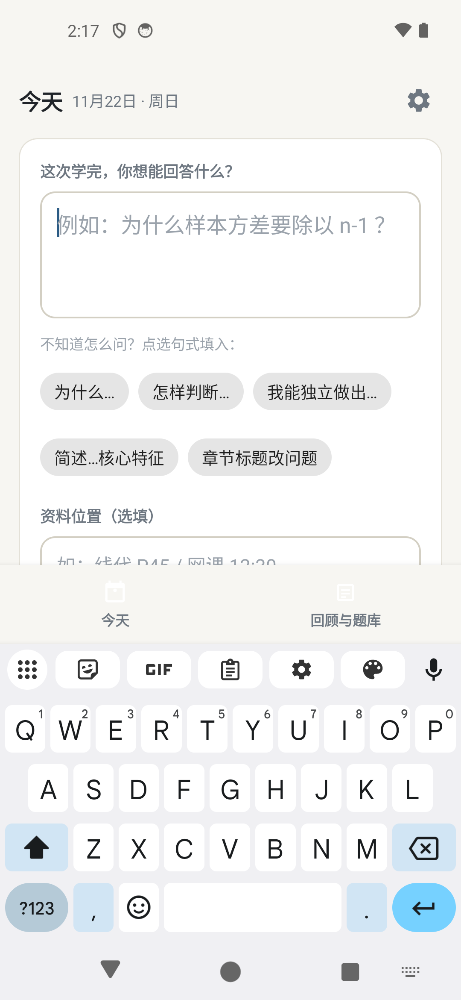
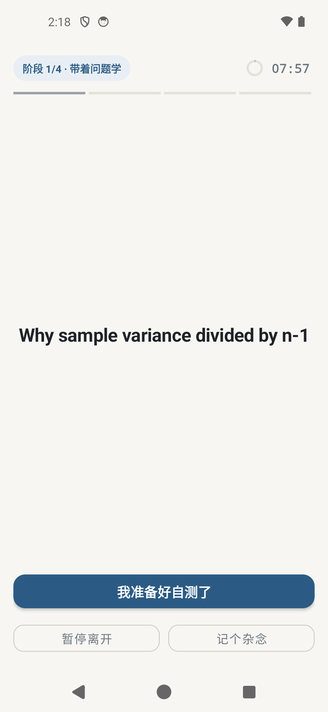
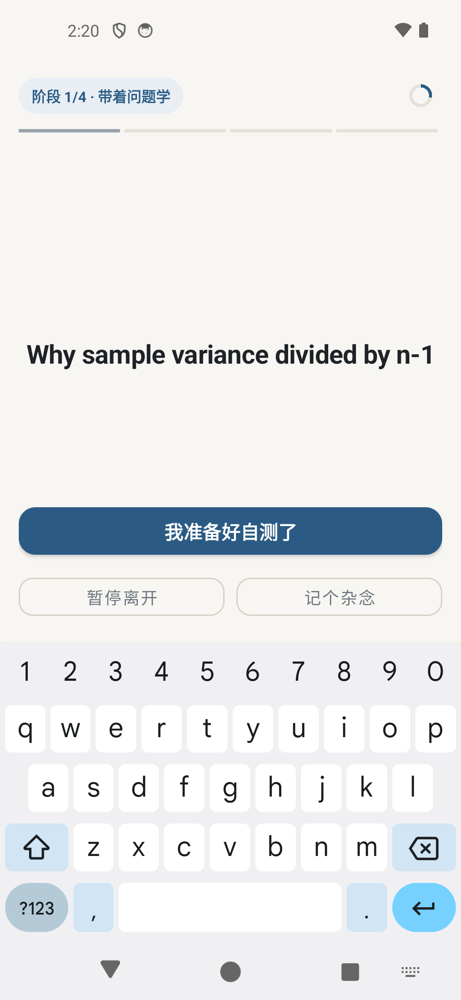
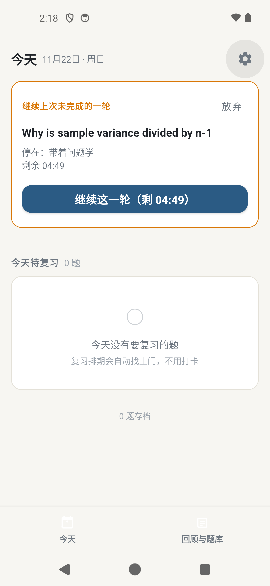

# 学一问 · XueYiWen

> 以具体问题为锚点的轻量级深度学习工具。原生 Android，本地优先，无账号、无后端。

**它解决三个具体问题：** 启动难 · 走神后断片 · 看书容易产生"我懂了"的幻觉。

核心闭环是：**提出问题 → 带着问题输入 → 盲答提取 → 暴露卡点 → 次日重测**。

<p align="center">
  
  
  
  
</p>

---

## 下载安装

| | |
|---|---|
| **最新版本** | [v1.0.0](https://github.com/Rstrict/xueyiweng/releases/latest) |
| **安装包** | `xueyiweng-v1.0.0.apk`（5.6 MB） |
| **最低系统** | Android 8.0（API 26） |
| **适配系统** | Android 16（API 36） |

```bash
adb install xueyiweng-v1.0.0.apk
```

或把 APK 传到手机点击安装，需允许"安装未知来源应用"。

> **首次使用建议**：进「设置」打开系统通知权限。这样你切出去看网课、或息屏时，阶段到点才收得到提醒。

---

## 这不是"网页套壳"

上一版做成了 PWA（浏览器里的网页 + 添加到桌面）。它的问题不是能不能用，而是在**不该让步的地方让了步**：

| 能力 | 网页方案（PWA） | 本项目原生实现 |
|---|---|---|
| **后台计时** | JS 被系统挂起，回前台重算 | 前台服务 `StageTimerService`，息屏/切网课照样走 |
| **到点提醒** | 浏览器通知常被限权限 | `AlarmManager.setExactAndAllowWhileIdle`，待机也准点 |
| **震动** | 需手势解锁，限制多 | `VibrationEffect` 波形（40-90-40ms 双轻震） |
| **音效** | WebAudio 需手势解锁 | `SoundPool` 播放**运行时合成**的木鱼声，无音频文件 |
| **存储** | IndexedDB，清缓存即丢 | SQLite 私有目录 + DataStore |
| **进程被杀** | 断点易丢 | 快照每 250ms 落盘，冷启动毫秒级还原 |

**计时不用 `setInterval` 累加。** 全部按绝对时间戳计算：

```
剩余 = 目标时长 − (Now − 阶段起点 − 累计暂停)
```

所以锁屏 10 分钟回来，数字是准的，不是"补算"出来的。

---

## 四个页面

### 1. `今天` — 极速启动台

- **唯一必填项：一个问题。** 打开即聚焦，60 秒内能进学习。
- 句式胶囊：`为什么…` `怎样判断…` `我能独立做出…` `简述…核心特征`，点一下填入并把光标置于末尾。
- `章节标题改问题` 给出三个学科的改写示例（数学定理／专业课概念／英语长难句）。
- 有未完成会话时，顶部自动换成**断点卡片**：显示停在哪一阶段、暂停备注、精确剩余时间，可继续或放弃。
- **不做**连续打卡、红点、断签焦虑。

### 2. `学习中` — 沉浸陪伴态

四阶段，每阶段都有独立时长（默认 8/2/10/4 分钟，共 25 分钟，可在设置里调）：

| 阶段 | 动作 | 界面要点 |
|---|---|---|
| **A 带着问题学** | 看教材/网课，只盯这一道题 | 问题 22sp 加粗居中，是屏幕唯一焦点 |
| **B 第一次盲答** | 合上资料，能写多少写多少 | 只显示原问题 + 一个输入框 |
| **C 核对与重练** | 对着盲区重新推导 | 自动展开折叠卡片，对照刚才的盲答 |
| **D 闭环再答** | 收起资料，用自己的话顺一遍 | 写修正 + 选掌握度 |

到点只做三件小事：单次木鱼声（<0.8s）+ 双轻震 + 系统通知。**不弹窗阻断**，允许你顺延看完当前例题。

点右上角计时可以切为**只显示圆环**，消除倒计时压迫感。

### 3. `回忆与核对` — 认知检验核心

严格物理隔离两个状态：

- **盲答态**：只显示原问题。三个出口——
  `写好了，去核对资料`（有字才亮起）/ `已在纸上 / 口头作答`（零阻力直通）/ `我卡住了`（展开"卡在哪里"单行输入）。
- **核对态**：上下并排展示原问题与刚才的盲答，下方是"补充纠正 / 核心卡点"。
- **自评**：三档按钮下方直接印下次复习时间，点一下就保存并排期。

### 4. `复习与回顾`

- **每日复习流**：一题一卡，先只给问题；`需要一点提示` 只揭开卡点关键词，`已作答，展开完整记录` 才给全部。
- **本周复盘**：稳固掌握 / 高频卡点 / 下次优先，三张卡点开看题。
- **全部题库**：任意题可看首次作答、卡点、修正、复习轨迹，可删除。

---

## 复习排期规则

不用 SM-2 那套浮点算法，用**透明、可手动覆盖**的阶梯间隔：

| 自评结果 | 下次间隔 | 队列处理 |
|---|---|---|
| 🟢 **独立答出** | 当前间隔 × 3（新题首次 **3 天**） | 连续 2 次独立 → 标记"已稳固"，移出高频队列 |
| 🟡 **需要提示** | 重置为 **1 天（次日）** | 保留本次补充的新卡点 |
| 🔴 **仍没弄懂** | **无下次日期** | 移入"待重学"，建议作为下一轮主问题 |

- 间隔上限 180 天，防止爆炸。
- **逾期包容**：没打开 App 的日子不惩罚。逾期题自动进"今天待复习"，只按逾期天数排序（逾期久的在前），不加权、不红点。

> **专业课背诵免制卡**：开局直接把小标题改写成带数量提示的问题（如"简述 XX 制度的 4 个核心特征"），阶段 B 直接口头背诵，阶段 C 把背漏的那条关键词记入"卡点"即可。

---

## 抗走神设计

- **杂念胶囊（Brain Dump）**：学习中突然想起"回微信""取快递"，点「记个杂念」，单行输入回车即消失。单向黑洞，本轮结束才统一展示处理。
- **断点现场快照**：主动暂停时弹轻量提示框（选填）："记一句停在哪"。回来恢复时高亮展示该句，10 秒接上思路。
- **切屏不惩罚**：承认手机本身就是看 PDF、听网课、按计算器的工具。

---

## 技术结构

```
app/src/main/java/com/xueyiweng/app/
├── logic/Logic.kt            ← 纯逻辑，无 Android 依赖（825 行）
│   ├── Stage / Mastery       枚举
│   ├── Dates                 本地时区日期工具
│   ├── Timer                 绝对时间戳计时、暂停/恢复
│   ├── Scheduler             阶梯排期
│   ├── Records               会话 → 记录，复习回写
│   ├── Queues                今日队列 / 待重学 / 稳固 / 高频卡点
│   ├── Stats                 周统计 / 独立答出率
│   ├── Transfer              JSON / Markdown 导入导出
│   └── JsonLite              自写 200 行 JSON（无第三方依赖）
├── data/
│   ├── Db.kt                 SQLiteOpenHelper + DAO（手写 SQL）
│   ├── Repository.kt         唯一数据入口，StateFlow 广播
│   └── SettingsRepository.kt DataStore 偏好
├── service/
│   ├── Feedback.kt           通知渠道 / 精确闹钟 / 震动 / 合成音效
│   ├── StageTimerService.kt  前台服务计时
│   └── Receivers.kt          到点广播 / 开机重建 / 每日刷新
└── ui/
    ├── MainActivity.kt       双层层：主内容 + fullscreen 沉浸层
    ├── MainViewModel.kt      会话快照 + 记录列表
    ├── home / session / review / archive / settings
    ├── SelfCheck.kt          设备内自检（11 项，跑在真机上）
    └── SessionDriver.kt      adb 驱动状态机（端到端验证）
```

**设计取舍说明：**

| 决定 | 原因 |
|---|---|
| 不用 Compose，用 View 系统 + ConstraintLayout | 依赖全在本地缓存、构建可复现；本项目是静态表单流，View 足够且包体更小（5.6MB） |
| 不用 Room，手写 `SQLiteOpenHelper` | 个人量级（几千条）裸 SQL 够用，省掉注解处理器这个编译不确定性来源 |
| 不引任何第三方 JSON 库 | 自带 `JsonLite`（含转义、嵌套、数字类型区分），减少供应链暴露面 |
| 无网络库、无账号体系 | Local-First，数据只在本机 |

**依赖清单**（共 11 个，全部来自 androidx / Kotlin 官方）：

```
androidx.core:core-ktx:1.13.1
androidx.appcompat:appcompat:1.7.1
com.google.android.material:material:1.14.0
androidx.constraintlayout:constraintlayout:2.2.1
androidx.activity:activity-ktx:1.9.3
androidx.fragment:fragment-ktx:1.8.9
androidx.lifecycle:lifecycle-runtime-ktx:2.8.7
androidx.lifecycle:lifecycle-viewmodel-ktx:2.8.7
androidx.recyclerview:recyclerview:1.4.0
androidx.datastore:datastore-preferences:1.1.7
org.jetbrains.kotlinx:kotlinx-coroutines-android:1.9.0
```

---

## 构建

**环境**：JDK 17 · Android SDK platform 36 · Gradle ≥ 8.13（AGP 8.13.2 要求）

> ⚠️ **项目路径不能含中文**。AGP 会直接拒绝编译：
> `Your project path contains non-ASCII characters`
> 如必须在中文目录下维护，建议真源码放 ASCII 路径，中文目录里放副本或软链。

```bash
# 调试包
./gradlew assembleDebug

# 发布包
./gradlew assembleRelease
```

产物位置：
```
app/build/outputs/apk/debug/app-debug.apk      (~7.8 MB)
app/build/outputs/apk/release/app-release.apk  (~5.6 MB)
```

完整构建说明（含换正式签名）见 [BUILD.md](BUILD.md)。

---

## 测试与验证

### 单元测试（JVM，26 项）

```bash
./gradlew testDebugUnitTest
```

覆盖：本地时区日期、计时差值、暂停冻结/恢复扣减、锁屏对齐、阶段切换边界、排期阶梯 3→9→27、稳固判定、需要提示重置、待重学无日期、队列筛选与排序、高频卡点判定、独立答出率、JSON 往返、坏数据容错、Markdown 导出、四阶段总时长。

### 设备内自检（真机跑，非模拟数据）

```bash
adb shell am start -n com.xueyiweng.app/com.xueyiweng.app.ui.MainActivity --es run_selfcheck 1
adb logcat -s XYW_SELFCHECK:*
```

实测输出节选：

```
2) 计时（+90s）：elapsed=90s remaining=390s progress=0.19
3) 暂停：冻结在 90s（应仍为 90）              ← 通过
   恢复：accumulatedPaused=600s（应为 600）    ← 通过
   恢复后 elapsed=90s（应仍为 90）              ← 通过
5) 落成记录：mastery=need_hint 下次复习=2026-11-23（明天）  ← 通过
6) 排期阶梯：3 → 9 → 27 天                     ← 通过
   第二次后已稳固=true                          ← 通过
   需要提示：间隔重置为 1 天，连续计数归零=true  ← 通过
   仍没弄懂：nextReviewDate=null                ← 通过
7) 今日队列：[overdue3, today]                  ← 逾期在前，稳固/待重学被排除
10) JSON 往返：ok=true 题干一致=true
11) 坏数据容错：保留=1 跳过=2
```

### 状态机端到端（adb 驱动）

```bash
adb shell am start -n <pkg>/.ui.MainActivity --es drive start  --es q "问题文本"
adb shell am start -n <pkg>/.ui.MainActivity --es drive stage  --es to recall_1
adb shell am start -n <pkg>/.ui.MainActivity --es drive answer --es a "盲答内容"
adb shell am start -n <pkg>/.ui.MainActivity --es drive pause  --es note "停在哪"
adb shell am start -n <pkg>/.ui.MainActivity --es drive resume
adb shell am start -n <pkg>/.ui.MainActivity --es drive finish --es m need_hint
adb shell am start -n <pkg>/.ui.MainActivity --es drive status
adb shell am start -n <pkg>/.ui.MainActivity --es drive queue
```

实测：

```
start    → stage=study target=480s
stage    → recall_1 target=120s
answer   → answer saved in recall_1
dump     → brainDump added (共 1 条)
stage    → verify   target=600s
stage    → recall_2 target=240s
pause    → paused at 闭环再答, note=...
resume   → accumulatedPaused=4s           ← 暂停时长被正确扣除
finish   → mastery=need_hint next=2026-11-23
queue    → total=4
             需要提示  next=2026-11-23   ← 次日
             仍没弄懂  next=null         ← 待重学
             独立答出  next=2026-11-25   ← 3 天后
             dueToday=0 relearn=1 stable=0
```

### 稳定性

Monkey 100 个随机事件（70% 触摸 / 30% 滑动）：**零崩溃零 ANR**。

---

## 数据与备份

- 全部数据存在应用私有目录（SQLite），卸载即清除。
- 支持**导出 JSON**（完整备份）与**导出 Markdown**（可直接贴进 Notion / Obsidian / 打印成纸质错题本）。
- 导入支持合并：同 ID 以复习进度更靠前者为准，坏数据自动跳过并计数。

---

## 已知限制

1. **`fullscreen` 沉浸层的无障碍遍历不完整** —— 会话页控件用 `uiautomator dump` 抓不全（截图与手动操作都正常）。已加 `accessibilityPaneTitle` 与 `importantForAccessibility`，仍需 TalkBack 真机复验。
2. **每日复习提醒只建了通道，未做强提醒** —— `DailyRefreshReceiver` 目前只做调度占位，尚未实现"早上播报今天有几题到期"。
3. **导出走系统分享面板** —— JSON/Markdown 落到 `cacheDir/exports/` 后调起分享，未做网盘/微信直传。
4. **发布包用 debug 证书签名** —— 可自用安装；上应用商店需换正式 keystore（见 BUILD.md）。
5. **时间全部按本地时区** —— 跨时区旅行时历史记录的"到期日"不换算（按设计如此：学习节奏跟本地作息走）。

---

## 许可

[MIT](LICENSE) © 2026 Rstrict
